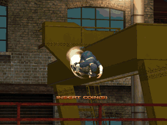
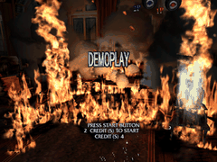
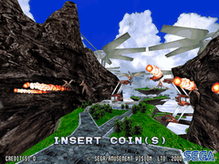
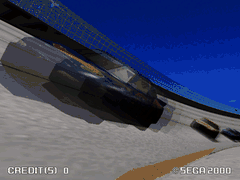
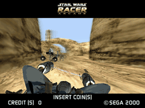
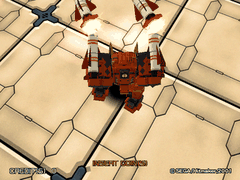
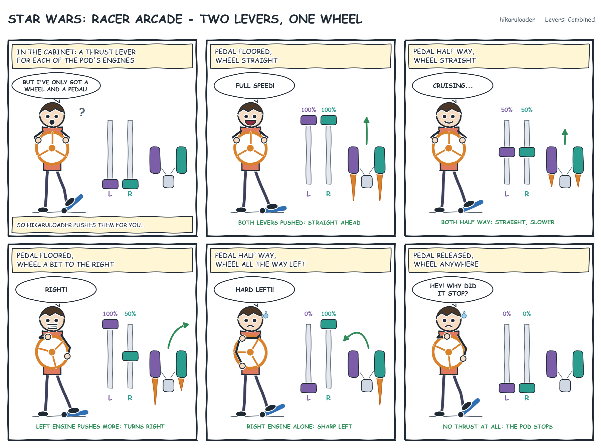
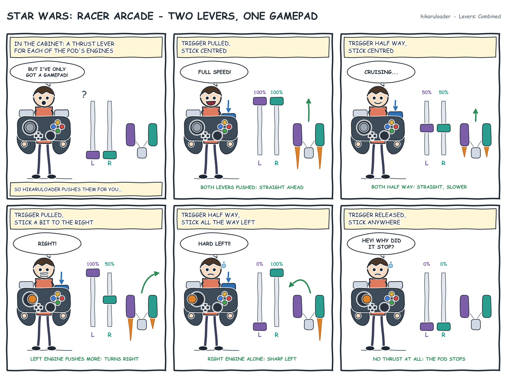

Hikaruloader (formerly Valkyrie)
================================

Hikaruloader emulates SEGA's Hikaru arcade board on Windows: Air Trix, Brave
Firefighters, Planet Harriers, NASCAR Arcade, Star Wars: Racer Arcade and
Cyber Troopers Virtual-On 4. It is the njz3 fork
(https://github.com/njz3/hikaruloader, formerly njz3/valkyrie) of Valkyrie,
Stefano Teso's Hikaru emulator, whose own notes close this file.

<table>
<tr>
<td align="center"><br>Air Trix</td>
<td align="center"><br>Brave Firefighters</td>
<td align="center"><br>Planet Harriers</td>
</tr>
<tr>
<td align="center"><br>NASCAR Arcade</td>
<td align="center"><br>Star Wars: Racer Arcade</td>
<td align="center"><br>Cyber Troopers Virtual-On 4</td>
</tr>
</table>

The games' attract modes, captured on Hikaruloader.

Hikaruloader, Copyright (C) 2026 Benjamin Maurin (njz3).
Valkyrie, Copyright (C) 2011-2013 Stefano Teso.
Released under the GNU GPL v3 or later: see LICENSE.

This file is the user's manual. To install or build the program, see
[INSTALL.md](INSTALL.md); what each version brings,
[CHANGELOG.md](CHANGELOG.md); what is left to emulate,
[TODO.md](https://github.com/njz3/hikaruloader/blob/main/TODO.md), in the sources.
The version shows in the window's title and in the settings' About tab.


What it needs
-------------

- Windows 10 or 11, 64-bit, and a graphics card with OpenGL 3.1. On a
  laptop with two (an Intel one and an NVIDIA or AMD one), the program asks
  for the faster one; Windows' graphics settings can still choose another.
- The program's folder: `hikaruloader.exe` and `data/`, from a
  release archive or built from the sources ([INSTALL.md](INSTALL.md)).
- The games, as MAME romsets, zips or 7z: the game's (`airtrix.zip` or
  `airtrix.7z`), its parent's for a clone (`airtrixo` needs `airtrix`'s as
  well), and `hikaru.zip` or `hikaru.7z`, the BIOS. Merged, split and
  non-merged sets all work: the files are found by their CRC32. A 7z is
  usually solid, unpacked whole into memory at the game's start: a little
  slower to start than a zip. Folders of unpacked files (`<game>/`) still
  load.
- For NASCAR Arcade's drive board, optionally, Sega Rally 2's set
  (`srally2.zip`): its EPR-20512 then runs on an emulated Z80. Without it the
  board is simulated, and the force feedback works the same.
- For the Emulation tab's two low-level options, optionally (see
  *Settings*): `jvs13551.zip` and `18wheelr.zip` (the I/O boards' programs),
  MAME's newer `hikaru.zip` (with the `x76f100.ic85` and `93c46.ic115`
  images). Without them the games play as before.


The games
---------

| Set | Game | Cabinet |
|---|---|---|
| `airtrix`, `airtrixo` | Air Trix (Rev A, original), 2000 | Four speakers |
| `braveff` | Brave Firefighters, 1999 | Two speakers |
| `pharrier` | Planet Harriers (Rev A), 2000 | Linked, four speakers |
| `sgnascar`, `sgnascaro` | NASCAR Arcade (Rev A, original), 2000 | Wheel and pedals, force feedback, linked, four speakers |
| `swracer` | Star Wars: Racer Arcade, 2000 | Linked, four speakers |
| `von4` | Cyber Troopers Virtual-On 4: Force (Rev E), 2001 | Linked, four speakers, a card reader |

Gaelco's games, on another board (two SH-4s and a PowerVR Neon 250), play too:

| Set | Game | Its controls |
|-----|------|--------------|
| `atvtrack`, `atvtracka` | ATV Track, 2002 | Handlebar and throttle (the Driving rows); the brake levers (Left brake, Right brake in the Gaelco section) or the brake pedal for both; Volume up and Volume down (Gaelco section) |
| `gfootbal` | Gaelco Football, 2002 | Two players: stick, buttons A, B and C on Button 1 to 3; player 2's rows in the Digital section (R, F, D, G and A, S, Q on the keyboard, 2 to start, or the second controller) |
| `smashdrv`, `smashdrvb`, `smashdrvs` | Smashing Drive, 2000 | Wheel, gas and brake as switches (the pedals); the horn (Gaelco section) or Start, which also starts; Volume up and Volume down (Gaelco section). Linked, two cabinets |

They run at `SH4_CLOCK`, as the Hikaru's games (their board's own clock is
200 MHz). Their settings and scores are kept in
`nvram/`, as the others'. ATV Track's and Smashing Drive's steering motor
drives the wheel's force feedback. Their lamps and coin counters, and Smashing
Drive's seat motor, go to the network outputs. Smashing Drive starts silent,
as its board does (its volume is kept nowhere): Volume Up is held for it at
each start, a second and a half, then Volume up and Volume down change it.

The Gaelco cabinets' own buttons are in the *Gaelco cabinets* section of the
Controls tab (`[Gaelco]` in `controls.ini`): volume, ATV Track's brake levers,
Smashing Drive's horn. ATV Track and Smashing Drive read none of the *Stick
and buttons* rows, which are the Hikaru games' (NASCAR Arcade's view change is
player 1's down there): a binding for one platform changes nothing in the
other's games. Gaelco Football, a stick and buttons game, reads those rows.

To link two Smashing Drive cabinets, set its *Link* setting in the test menu
(master on one, slave on the other, then *Exit and save*), and the `[Network]`
section of `hikaruloader.ini` as for the other linked games.

What is still wrong in each game is in
[TODO.md](https://github.com/njz3/hikaruloader/blob/main/TODO.md), in the sources.


Starting a game
---------------

Started without arguments, Hikaruloader shows its picker: the Hikaru and
Gaelco games whose files are all in the games folder, none when there are
none. NAOMI, Atomiswave and GD-ROM games are not in it for now: they start
from the command line. The arrows (or a controller's D-pad) choose, Enter (a controller's A,
or a double click) launches, Tab opens the settings, Escape quits. The games
folder is the one of the settings (Picker tab), else `roms` beside the
program. There can be several, separated by `;`
(`D:\roms;E:\mame\roms`), looked in in that order: the BIOS can be in one,
the games in another.

In a game, Escape (a controller's Guide + B) goes back to the picker; when
the game was started from the command line, it quits. F9 (Guide + Start)
quits at once.


Command line
------------

```
hikaruloader.exe [options]
```

| Option | What it does |
|---|---|
| `-R <folder>` | The games folder for this start: the MAME zips or 7z, or a folder per game; several separated by `;` (`-R "D:\roms;E:\mame\roms"`) |
| `-r <set>` | Starts that game at once, by its MAME set name (`-r sgnascar`), without the picker |
| `-z <file>` | With `-r`: the zip or 7z holding that game, whatever its name (`-r vstrik3c -z D:\roms\vs3.7z`). Its folder is the first looked in for the BIOS, the parent and the CHD, then the games folders |
| `-l <file>` | Loads that save state at the start: the game goes on from its frame. `-l 0` to `-l 4` load one of the game's own states, those F4 saves, 0 the latest |
| `-n <frames>` | Quits after that many frames |
| `-L`, `--list` | Lists the games and quits: title, set, version, year and maker, the MAME sets each one needs, each ROM file with its CRC32, and how many of them the games folder holds |
| `--write-dir=<folder>`, `--write-dir <folder>` | Writes everything in that folder: settings, log, saves (see "Write directory") |
| `--display-mode=<mode>`, `--display-mode <mode>` | The display mode for this start, in place of the settings' `DISPLAY_MODE`, which stays as it is in `hikaruloader.ini`: `WINDOW`, `FULLSCREEN` or `BORDERLESS`, each also with `_STRETCH` (`--display-mode=FULLSCREEN`) |
| `-v` | More messages in the log |
| `-h` | Shows the options |

For example:

```
hikaruloader.exe -R D:\roms -r airtrix
hikaruloader.exe -r vstrik3c -z D:\naomi\vstrik3c.zip
hikaruloader.exe -r sgnascar -l D:\states\race.hlstate
hikaruloader.exe -r swracer -l 2
hikaruloader.exe -L -R D:\roms
hikaruloader.exe --write-dir=C:\Racecab\Saves\hikaruloader -r swracer
```


Keys and controllers
--------------------

| By default | Action |
|---|---|
| F5, F6 | Test and Service. Test opens the game's test menu: its settings, its bookkeeping, the BIOS's system settings |
| 5, 6 | Coins |
| Enter, a controller's Start | Start |
| The arrows, a controller's D-pad or left stick | Up, down, left, right |
| Left Ctrl, Left Alt, Left Shift, Z; a controller's A, B, X, Y | Buttons 1 to 4 |
| A controller's left stick and triggers, a wheel's axes | Steering, accelerator, brake (the arrows too, all the way) |
| Page Up, Page Down; a controller's R1, L1 | NASCAR Arcade's gear up, down |
| V; a controller's Y | NASCAR Arcade's view change (`ViewChange`, linuxloader's name; Down too, as on the cabinet's I/O board) |
| P; Guide + X | Pause |
| F4, F1; Guide + R1, Guide + L1 | Save a new state, load the latest or the one chosen |
| F2, F3 | Choose the state F1 loads, newer or older, among the last five (shown at the top of the picture) |
| A mouse or a light gun | Brave Firefighters' sights, Planet Harriers' stick (see "Mice and light guns") |
| Tab; a controller's Back, Guide + Back | Settings |
| F7; Guide + Y | Virtual-On 4's and Club Kart's card: in the reader's slot, or taken back (see below) |
| F12 | The frame rate over the picture |
| F8 | NAOMI cabinets of several boards: the next board's picture; with several screens, the middle one and a board without a screen in turn (F355 Deluxe's master) |
| F9; Guide + Start | Quit |
| Alt+Enter | Full screen (the desktop's) or a window, for this start |
| Escape; Guide + B | Back to the picker, or quit |

The Controls tab of the settings binds each action to keys, to the
controllers' buttons and axes (a wheel and its pedals included, with their
dead zones), to a mouse's or a light gun's, several to each. The bindings go to `controls.ini`, written at
the first start with a comment on each line, in the syntax of linuxloader and
windowsloader. Its buttons can be numbered from 1, as Windows and vJoy do.

**Hotkeys.** A controller's Guide button (Xbox, PS or Home), held, turns its
other buttons into the emulator's commands, as RetroArch has them: Guide +
Start quits, Guide + B goes back to the picker, Guide + Back opens the
settings, Guide + R1 and L1 save and load the state, Guide + X pauses,
Guide + Y takes Virtual-On 4's card. While Guide is held the game sees none
of the controller's buttons, nor one pressed then until it is let go: Guide
+ B does not also press button 2. They are bindings like the others
(`ExitGame = KEY_F9, GC0_BUTTON_GUIDE + GC0_BUTTON_START` in `controls.ini`);
in the Controls tab, hold Guide and press a button to bind one. A
`controls.ini` of an earlier version keeps its bindings as they are: bind
the hotkeys in the Controls tab, or delete the file to get the defaults.
On Windows, Guide also opens the Xbox Game Bar: Windows' settings (Gaming,
Xbox Game Bar) turn its controller button off.

**Background input.** The Controls tab's *Read the controllers in the
background* (off by default, `[Input]` `BACKGROUND_INPUT` in
`hikaruloader.ini`, taken at once) keeps the joysticks, wheels and
controllers working while another window has the focus, their hotkeys too.
The keyboard only ever works with the focus.

**Wheel rotation.** With a wheel, NASCAR Arcade's wheel goes from one end
to the other over the wheel's whole turn by default. The Controls tab's
*Wheel rotation* makes it 270, 360, 540, 900 or 1080 degrees of the wheel's
turn instead, the game's wheel then at its end before the wheel is; *Your
wheel's turn* is the rotation set in the
wheel's driver (Logitech G HUB, Thrustmaster's or Fanatec's control panel),
900 degrees for most, which SDL cannot read. A wheel's axis only
(`JOY<n>_AXIS_<a>`), not a game controller's stick. In `hikaruloader.ini`:
`[Input]` `WHEEL_ROTATION` and `WHEEL_RANGE`.

**NASCAR Arcade's gears.** The cabinet has a four-speed H shifter; the game
asks for AUTOMATIC or MANUAL at the start of a race. Shift up and Shift
down (`GearUp`, `GearDown` in `controls.ini`, linuxloader's names) move a
gear at each press, from neutral to 4; an H shifter binds its positions
(`Gear1` to `Gear4`, `GearNeutral`), as sm2-emu has them. The Controls
tab's *Gear shifter*: *Neutral when no gear is engaged*, an H shifter's
lever in none of its gears in neutral, as on the cabinet (else the last
gear stays); *Neutral between gears*, Shift up and down going through
neutral that long, as a real lever (`[Input]` `SHIFTER_NEUTRAL`,
`SHIFT_NEUTRAL_MS`). The gear the game reads shows in *What the game
receives*.

**Star Wars: Racer Arcade's levers.** The cabinet has two levers, each the
thrust of one of the pod's engines, pushed forward: even, the pod goes
straight; the side pushing harder turns it the other way; both back, it
stops. The Controls tab's *Levers*: *Combined* (the default), the
accelerator gives the thrust of both and the wheel the difference, the pod
turning to the side steered, for a wheel and pedals or a controller's
stick and trigger; *Original*, an axis each, as on the cabinet
(`P1_LeftLever`, `P1_RightLever`: a controller's two sticks pushed up by
default) (`[Input]` `TWIN_LEVERS`). Button 1 is the boost, button 2 the
brake; Left and Right are the game's left and right buttons (◁ ▷, the
menus).






Settings
--------

Tab opens the settings, in the picker and in a game. Save writes them to
`hikaruloader.ini` beside the program, each with a comment giving its values
and its default; the file can be edited by hand as well. A few take effect at
the game's next start, as the window says.

**Display.** The picture's settings are those of linuxloader, Supermodel,
Flycast and sm2-emu, under the same names in `hikaruloader.ini`; each takes
effect at once.

- *Internal resolution* (`RENDER_SCALE`): the 3D drawn at 640x480, the
  board's (native), or 2 to 6 times larger (1280x960 ... 3840x2880; 854
  wide in widescreen), then fitted to the window. Sharper edges and
  textures, more work for the graphics card; the 2D (texts, logos) keeps its
  size. Larger than the window, the picture is averaged down
  (supersampling): x2 smooths the edges even in a 640x480 window.
- *Aspect ratio* (`ASPECT_RATIO`): the frame the picture is shown in, and
  how the picture fills it. *Original*, the picture's own shape (4:3, 16:9
  in widescreen); *4:3* or *16:9, black bars*, that frame with the whole
  picture in it; *stretched*, the picture fills the frame, deformed;
  *cropped*, it fills the frame at its own shape, cut at the sides or above
  and below. A crop's *position* moves the part kept (`CROP_POSITION`, -100
  to 100), and *Bend the cut parts onto the edges* (`CROP_BARREL`) shows
  them squeezed on the edges, as on a cylinder seen from the front, the
  middle undistorted (`BARREL_CENTER`, `BARREL_RADIUS`).
- F355 Challenge's drive board (EPR-21867) is emulated on the force feedback wheel; its commands go out as `m3ffb` and a client's `m3ffb_rx` answers replace the emulated ones, as on NASCAR Arcade.
- The servo board 838-14174 of the NAOMI wheels (Club Kart, The King of Route 66, Driving Simulator) is emulated on the force feedback wheel; its frames also go out on the network outputs as `midiffb = HH HH HH`. A client that answers `midiffb_rx = HH..` (BackForceFeeder, in front of a real board) takes over: the game reads its answers and the wheel plays nothing, until it leaves.
- NAOMI GD-ROM games need the game's zip (with its DIMM board's PIC) and its
  CHD in a folder named as the game, as MAME keeps them: `roms/initdv3e.zip`
  and `roms/initdv3e/gds-0033.chd`. Atomiswave games need `awbios.zip`. Initial
  D's magnetic card is inserted with F7.
- *Several boards* (`MULTI_SCREEN`), in the *Game* tab while a game of several screens runs, for the NAOMI cabinets of several boards; in the file also for the Hikaru's second video output (`WINDOWS`, in a window of its own when a game drives it), read when a game
  starts: `ONE` shows one board (F8 the next), `SIDE_BY_SIDE` puts the screens in a row in the
  window, for a very wide monitor, `WINDOWS` gives each a window. `SCREEN_ORDER` gives the boards
  with a monitor, left to right (`2,1,3`). With `WINDOWS`, a list gives each window's monitor, by its name, its device,
  its mode and its place on the desktop, or AUTO. In the file, `SCREEN_1_DISPLAY` to `SCREEN_3_DISPLAY`:
  a part of its name (`DELL`), `INDEX:1` counting from 0, or the number of its `DISPLAY` device
  (`2`); the log lists the monitors at its start.
- *Display mode* (`DISPLAY_MODE`): window, full screen or borderless full
  screen (both at the desktop's resolution: no mode change), the frame at
  its shape in the middle; or *stretched* (`WINDOW_STRETCH`...), the frame
  filling the window or the screen. Then the window's size, 1x to 4x
  640x480.
- *Whole multiples only* (`INTEGER_SCALE`): the picture at 1x, 2x, 3x... its
  size, for even pixels, with larger black bars.
- Also v-sync, the frame limiter and its rate, the frame rate shown (F12),
  the frame number in the title (to report a glitch), the mouse pointer
  hidden (the default; it comes back in the picker and the settings).

An `hikaruloader.ini` from before keeps its choices: `ASPECT_RATIO = INTEGER`
becomes *Original* with whole multiples, `STRETCH` *Original* in a
stretched display mode, `SCALE_FILTER` is read as `SCALING_FILTER`, and
`RENDER_SCALE` from `[Enhancements]`.

- *A CRT driven at a super resolution* (1920x240, say): choose its real
  shape as the aspect ratio, *4:3* or *16:9, black bars*, and a stretched
  display mode. The frame then covers the screen whatever the shape of its
  pixels: the black bars fall right, and a 4:3 picture is not stretched on
  a 16:9 screen.
- *Scaling filter* (`SCALING_FILTER`): Sharp pixels, or Smooth. Down to 240
  rows on a CRT, Smooth makes each row the mean of two, where Sharp pixels
  drops one in two (thin lines, small texts).
- *Draw on a thread of its own* (on by default): each frame is drawn while
  the next one is emulated. Faster when the drawing slows the game, but the
  picture comes a frame later.
- *Sort the translucent polygons at each pixel* (`SORT_TRANSLUCENT_PIXELS`,
  on by default): smoke, glass, flames and lights blended from the farthest
  at each pixel, as the board does, right where they cross. It needs a card
  with OpenGL 4.3 and no MSAA; off, or without them, each mesh is sorted as
  a whole, lighter for a weak graphics card. The Gaelco games' too (their
  chip sorts them so); off, each of their triangles is sorted whole.
- *Widescreen 3D (16:9)*: the 3D is drawn at 854x480 and seen wider; its
  middle stays as the game draws it. The 2D (texts, logos) stays 4:3 in the
  middle, or is stretched to 16:9 for a game that needs it. The games were
  made for 4:3: objects may be missing at the sides, or appear late. The
  Gaelco games too: their HUD is the 2D, their sky and full-screen pictures
  stretched with it; ATV Track leaves pieces of ground out at the sides.
- *Draw distance* (x1 to x4): the scenery's detailed models and its fog go
  that many times farther. What a game leaves out itself is not drawn.
- *Bezel* (`BEZEL`): what is around the picture where the window is wider
  than its frame (a 4:3 game on a 16:9 screen). *Off*, black; *the
  picture's edges, blurred* (`BLUR`), its own edges spread over the sides,
  blurred and dimmed; *the game's bezel picture* (`IMAGE`), a picture laid
  over the window with the game in its screen, placed there as the aspect
  ratio's settings place it in a window of the screen's size. The
  pictures are in Batocera's format, yours to put in `artwork\bezels\`
  beside the program: `<set>.png`, with `<set>.info` beside it giving where
  its screen is (`width`, `height`, `left`, `top`, `right`, `bottom`, in
  pixels); without the `.info`, the screen is the picture's see-through
  middle. A clone without its own takes its parent's; `default.png` serves
  the others; without any, black. None is shipped.

**Enhancements.** Beyond the board's own picture, all off by default; each
takes effect at once (`[Enhancements]` in `hikaruloader.ini`).

- *Antialiasing (MSAA)* (x2, x4, x8; not all the meshes' depth bias, see
  "When something goes wrong"): the 3D's edges smoothed by several
  samples a pixel; the edges inside the textures (fences, leaves) stay.
- *Edge smoothing (FXAA)*: the 3D's edges smoothed once drawn, cheaper than
  MSAA, a little blurrier. The 2D is left alone.
- *Anisotropic filtering* (x2 to x16): the textures seen at a slant (roads,
  floors) stay sharp into the distance.
- *Texture upscaling* (Scale2x, Scale4x): the textures enlarged, the edges
  of their flat colours (texts, signs, markings) kept sharp; photographic
  textures change little. More memory, slower texture loads.
- *Bloom* (0 to 100 %): a glow around the 3D's bright parts.
- *CRT preset* (`CRT_PRESET`): a CRT drawn over the whole picture by a
  libretro shader preset (`.glslp`, run by 86Box's rules): its tube, curved
  glass, scanlines, phosphor mask and glow. Shipped in `data\crt\`: Lola
  Retro's, by Zoki (MIT licence, `data\crt\lola-retro\LICENSE`), as Odin
  ships them: `sega-monitor-29` and `sega-projector-50`, the cabinets'
  29-inch monitor and 50-inch projector; `pc-monitor-vga`, PC monitors of
  the VGA days from `-good` to `-extreme`, each also `-flat`. The picture is
  given to the preset at its own size (640x480, 854x480 in widescreen),
  whatever the internal resolution. The tube stays 4:3 (a widescreen
  picture is squeezed into it), and a crop's bent edges are not drawn. The
  presets need OpenGL 3.3's sampler objects and GLSL 1.50 from the driver,
  and the larger ones a recent graphics card; a preset that cannot run is
  logged and left out. The ini also takes a `.glslp` file's path.
- *CRT filter* (0 to 100 %): a CRT's scanlines and its phosphors' stripes on
  a flat screen, over the whole picture. It needs 960 rows or more (a window
  of x2 or more, full screen); on a CRT itself, leave it at 0. Greyed with a
  CRT preset, which draws its own: both would make their stripes beat.

**Sound.** The speakers: the sound card's, or mono, stereo, 2.1, quad, 5.1,
7.1. The games with four speakers play their front on the main sound board
and their rear on the second one; on two speakers the rear comes at the
front, 3 dB lower. Also the front/rear balance and the volume.

- *Attract sound*: the BIOS's ADVERTISE SOUND. ON by default; ON or OFF are
  written to the game's EEPROM at its start, AUTO keeps the EEPROM's (a new
  board has it off, the attract silent).
- *Latency* (20 to 200 ms, 50 by default): the sound kept ahead. Less brings
  the sound closer to the picture; more avoids gaps on a slow PC.
- *Sound emulation*: Optimized (the default) or Interpreted, slower. Both
  give the same sound.

**Emulation.**

- *Region*: the board's country (Japan, USA, Export, Australia, Korea),
  Export by default, written to the game's EEPROM at its start; AUTO keeps
  the EEPROM's. The
  games take their language from it: Brave Firefighters speaks English
  outside Japan.
- *SH-4 clock* (100 to 200 MHz, 150 by default, at the game's start; down to
  20 in `SH4_CLOCK` of `hikaruloader.ini`): the board's 200 MHz is spent mostly
  waiting, which costs real time on the PC. At 100 MHz some games show
  graphical glitches. Air Trix needs 100 at least: below, its skater's body is
  missing. The games' timers count in
  real time whatever the clock.
- *SH-4 processors*: the recompiler (the default) or the interpreter, the
  same machine either way. *Memory access*: the same, three ways.
- *I/O board running its own program* (`IO_BOARD_PROGRAM`, off by default,
  at the game's start): the JVS I/O board's processor runs its program, as
  on the cabinet, instead of its simulation: the 837-13551's TMP90PH44
  running `315-6215.bin` (MAME's `jvs13551.zip`), NASCAR Arcade's 837-13741
  running `epr-21868.ic7` (MAME's `18wheelr.zip`), both in a games folder.
  The test menu's JVS TEST then shows the board's own answers. Test and
  Service go through that board, as on a cabinet, no longer through the
  main board's switches. Without the file, the simulation (the log says so).
- *Security chips* (`SECURITY_CHIPS`, off by default, at the game's start):
  the ROM board's X76F100 secure EEPROM and the main board's 93C46 answer
  from their images, `x76f100.ic85` and `93c46.ic115` (MAME's newer
  `hikaru.zip`), and the BIOS checks them instead of skipping the check
  (`ERROR 2` on a bad chip); NASCAR Arcade's protection answers as its Actel
  FPGA. Without the images, the chips blank and the check skipped. The log
  tells their commands.

**Outputs.** The cabinet's lamps and NASCAR Arcade's drive board commands,
sent over the network to the programs that drive real ones (see *Cabinet
outputs* below): on or off, the ports, whether a program is connected, and
the list of what the game sends with its values.

**Picker.** The games folders (typed, separated by `;`, or each added with
*Add a folder...*, Windows' folder dialog; a folder not found is marked so),
the language (English, French; Automatic follows Windows), the log file,
the games' pictures.

The picker shows each game's pictures, by MAME set name (a clone without
its own takes its parent's):

- Your own, in `artwork\` beside the program: `<set>.png` or `.jpg`, or the
  folders of MAME's packs, `titles\`, `snap\`, `flyers\` and `marquees\`,
  with `<set>.png` or `.jpg` in them.
- Downloaded, when the Picker tab's *Download the games' pictures* is on
  (off by default): from the Arcade Database (adb.arcadeitalia.net, by
  motoschifo) into `cache\artwork\`, in the background, one game at a time,
  those of the games found; a game asked once is not asked again. The
  pictures' copyrights belong to their owners.


Saves and files
---------------

- `nvram/<game>.nvram`: the board's EEPROM (the game's settings, the BIOS's
  system settings) and its battery-backed RAM (records, bookkeeping), saved
  by themselves: the EEPROM half a second after the game writes it, the RAM
  every ten seconds when it changed, both when the game ends. Deleting the
  file gives the game a new board's settings back. The board's clock shows
  the PC's time; set in the test menu (CLOCK SETTING), how far it is from
  the PC's is kept there too.
- `nvram/von4.card`: Virtual-On 4's card, its three tracks (see below).
- `<game>-0.hlstate` to `<game>-4.hlstate`: the save states of F4, 0 the latest
  and 4 the oldest: each F4 makes a new 0, moves the others up and drops the
  last. F1 loads the latest, unless F2 (newer) or F3 (older) has chosen another
  (its number and age are written at the top of the picture); then it is the
  latest again. They hold the whole machine; a state may not load in another
  version of the program.
- `hikaruloader.ini`, `controls.ini`: the settings and the controls.
- `hikaruloader.log`: the messages of the last start (the one before in
  `hikaruloader.old.log`). On by default; the Picker tab's "Write a log
  file" (`LOG_FILE`) turns it off from the next start. Join it to a bug
  report.
- `data/games.json`: the list of the games and their files.
- `cache\shaders\`: each game's shader programs, listed as the game shows
  them and kept compiled for the graphics card, so that the next start
  prepares them before the first frame (no stutter the first time an
  effect shows). Deleting the folder only makes the next start slower.
- `data\shaders\`: the programs the six games show, listed with the
  program: the first start prepares them as well.


Write directory
---------------

A write directory keeps everything the program writes in one folder, so that
the rest of the disk can stay read-only: a cabinet under Windows' Unified
Write Filter, or games on a network share. Give it with `--write-dir`, or as
`WRITE_DIR` in the `[Picker]` section of the `hikaruloader.ini` beside the
program; a relative path is relative to the program's folder.

The settings, the controls and the log then go to its root, each game's
nvram and states to `<folder>/<game>/`. When it lacks the settings, the
controls or a game's nvram (its first start, or after a wipe), the usual file
is copied there, and from then on only the copy is used: after an update,
delete the copy to take the new file. If the folder cannot be created or
written to, nothing is saved at all, the usual files are only read, and a
notice says so for 20 seconds.


Linked cabinets
---------------

Planet Harriers, NASCAR Arcade, Star Wars: Racer Arcade and Virtual-On 4 can
link two cabinets or more. Each cabinet is one Hikaruloader, the instances
joined in a ring over the network, as the boards' optical fibres were: the
`[Network]` section of `hikaruloader.ini`.

- `LINK`: the BIOS's COMMUNICATION MODE, `MASTER`, `SLAVE`, `RELAY` or
  `NO_LINK`, written to the game's EEPROM at its start (`AUTO` keeps the
  EEPROM's; a new board has `NO_LINK`). One master per ring.
- Each instance listens on `PORT_IN` for the previous one, and connects to
  the next one at `ADDRESS_OUT` and `PORT_OUT`; the last one connects back
  to the master.
- Two on one PC, each with its own write directory: the master with
  `PORT_IN = 1970` and `PORT_OUT = 1971`, the slave the other way round.
- Star Wars: Racer Arcade and Virtual-On 4 want a different seat on each
  cabinet, in the game's test menu (SEAT NUMBER, SEAT LETTER); NASCAR Arcade
  and Planet Harriers number their cabinets by the ring.
- `COMM_BOARD`: the communication board. `SIMULATED` (the default) does its
  program's work in Hikaruloader, for two cabinets at most. `PROGRAM` runs
  the program the game gives the board, on its own 68000 as on the
  cabinet: three cabinets and more (Star Wars: Racer Arcade and Virtual-On 4
  up to four, NASCAR Arcade up to eight). All the cabinets of a ring must
  have the same setting.

With `SIMULATED`, the linked instances run frame by frame together: when one
pauses, the others wait, and they drop the link after 5 seconds; when one
enters its test menu or quits, at once.

NAOMI games link the same way: F355 Challenge Twin, and the others with a
communication board (Club Kart, Initial D, Virtual-On Oratorio Tangram and
more). `LINK = MASTER`, `SLAVE` or `NO_LINK` writes the game's own setting at
its start (a game not known has it set in its test menu); `LINK_NODE`, 1 to
7, is a slave's number on the ring, its car or its seat. `AUTO` leaves the
game's backup as it is: F355 Twin then starts alone, unlinked. Driving
Simulator's three systems are all in one Hikaruloader, no `[Network]` needed.

The GD-ROM games of a Net DIMM board (Virtua Fighter 4, Dragon Treasure, World
Club Champion Football, Mahjong MJ) have a real network of their own: UDP and
TCP sockets, on the addresses the game believes it has. The settings of
`[Network]` for them:

- `DIMM_IP`: the board's address, as the game's menus show it. Default
  `192.168.1.30`.
- `DIMM_MAP`: where the other boards are, entries separated by `;`, each
  `address=host`, `address:port=host:port` or `address=host+offset` (the
  game's port moved by the offset). `address` is one the game uses (`*` any
  other, or a name it asks the DNS for); `host` the real one. Addresses left
  out are not reachable, no name is looked up: by default nothing leaves the
  PC.
- `DIMM_PORT_OFFSET`: added to the ports this board binds, for two instances
  on one PC. Default `0`.
- `DIMM_LISTEN`: the board's bound ports on the PC's network too; else on
  `127.0.0.1` alone. `false` by default: two PCs want it `true`. It also opens
  the board's own TCP service (port 10703 plus `DIMM_PORT_OFFSET`), used by
  the machines that put a game on the DIMM or read it.
- `DIMM_SERVICE_IP`: the address of that service, `127.0.0.1` by default;
  `0.0.0.0` for every interface.

Club Kart for Cycraft and Initial D Ver. 3 Cycraft Edition expect the motion PC
of their moving cabinet on the network, at `192.168.1.1`, port 2000. Hikaruloader
answers in its place so that the game starts, with nothing to set (the seat
does not move). A real motion PC: `DIMM_MAP = 192.168.1.1=<its address>`.

Two instances on one PC, each with its own write directory, the second with
`DIMM_IP = 192.168.1.31`, `DIMM_PORT_OFFSET = 100` and
`DIMM_MAP = 192.168.1.30=127.0.0.1+0`, the first with
`DIMM_MAP = 192.168.1.31=127.0.0.1+100`.

### Three or four cabinets

Set `COMM_BOARD = PROGRAM` on every instance, and chain their ports in a
ring. Four on one PC, each with its own write directory
(`--write-dir C:\Racecab\Cab1`, `Cab2`...):

| Cabinet | `LINK`   | `PORT_IN` | `ADDRESS_OUT` | `PORT_OUT` | Seat (SWRACER, VON4) |
|---------|----------|-----------|---------------|------------|----------------------|
| 1       | `MASTER` | 1970      | 127.0.0.1     | 1971       | 1, A                 |
| 2       | `SLAVE`  | 1971      | 127.0.0.1     | 1972       | 2, B                 |
| 3       | `SLAVE`  | 1972      | 127.0.0.1     | 1973       | 3, C                 |
| 4       | `SLAVE`  | 1973      | 127.0.0.1     | 1970       | 4, D                 |

For three, the third connects back to 1970. On several PCs, `ADDRESS_OUT` is
the next PC's address (the firewall asks once). Set each cabinet's seat once
in the game's test menu (GAME ASSIGNMENTS), then quit it: the game checks
the ring when it starts again (Star Wars: Racer Arcade shows each node's
game, then CONNECTION WAS ESTABLISHED; Virtual-On 4 THIS IS MASTER SITE or
SLAVE SITE and the seat letter).

With `PROGRAM`, the boards of a ring keep the same time as the real ones
did, a quarter of a millisecond apart at most, so the instances run in step
at a fraction of a frame: the ring goes as fast as its slowest instance, and
the link costs some of each one's speed. Four instances need a fast PC: on
an 8-core laptop, four of Star Wars: Racer Arcade raced each other at about
25 frames a second (four racing alone, unlinked, at 37), two at 36. When an
instance pauses (the settings window), the next one waits
2 seconds, then runs on alone until it is back; an instance in its test
menu holds its board, and the others go on without it. A cabinet started
later, or a state loaded, takes the ring's time again by itself. Linking
PCs over a network is not tried yet.


Virtual-On 4's cards
--------------------

Outside the USA region, Virtual-On 4 has a card reader, emulated: a VO4 card
keeps a pilot's name, rank, Virtual-roid and records. The card is a file,
`nvram/von4.card` (with a write directory, its copy). F7 (*Card*,
`P1_Card1Insert` in `controls.ini`) puts it in the reader's slot, or takes it
back: the game takes it in when it asks for it (at the choice of the
Virtual-roid), and gives it back at the end; it is taken 3 seconds later.
Without a card, the game plays as usual.

A new card comes from the VO4 terminal: the game in its card vending mode.

1. In the test menu (F5), GAME TEST MENU, GAME ASSIGNMENTS: GAME START MODE
   to VENDOR. The BIOS's COIN ASSIGNMENTS must be FREE PLAY (or one of the
   two the game lists), else the game says COIN ASSIGNMENTS ERROR.
2. Out of the test menu, Start, then the new card: the pilot's name, the
   Virtual-roid. The reader's stocker gives a blank card; the game writes
   it, prints it and gives it back. The card file before, if any, is kept
   as `nvram/von4.1.card`.
3. GAME START MODE back to GAME, to play.

As on the board, a card allows a number of sorties; the terminal's other
choice moves a card's records to a new one, the old card then allowing no
more. CARD R/W OFF, in GAME ASSIGNMENTS, turns the reader off.


Force feedback
--------------

NASCAR Arcade's drive board turns the game's commands into force feedback on
the first wheel or joystick that has it (DirectInput): a constant force,
with the servo board's spring and friction. With `srally2.zip` among the
games, the board runs Sega Rally 2's own program (EPR-20512) on an emulated
Z80; without it, a simulation of that program (`DRIVEBOARD_SIMULATED=1` in
the environment forces the simulation). It starts in some 11 seconds (CF,
CE, CD, then CC), as on the cabinet. Two environment variables adjust
it: `FFB_GAIN`, a percentage (100 by default), and `FFB_INVERT=1` for a
wheel that pushes the wrong way. The Controls tab's *Force feedback gain*,
0 to 300% (`[ForceFeedback]` `GAIN` in `hikaruloader.ini`, 100 by default,
taken at once), multiplies all the forces, of every game, on a wheel and on
a controller's motors; above 100% the strongest stop at what the device can
do.

With a wheel rotation (see "Keys and controllers"), the game's own forces
follow the wheel's position as the game reads it, already scaled; the servo
board's centring spring, which the wheel works out itself from its own
position, is made as much stiffer and its dead band as much narrower, as far
as the wheel's strongest spring goes. The friction, which follows the
wheel's speed, stays as it was.

Star Wars: Racer Arcade's cabinet has no motor (the deluxe one a bass shaker
under its control panel, fed with the option sound board's speakers): its
force feedback is made from what the game does, read from its memory as the
telemetry is. On a wheel (DirectInput): a centring and a damping that grow
stiffer with the speed, the weight of the turns, a kick away from a wall or
a pod hit, as strong as the speed lost, a rough shake along a wall, the
centring's middle moved to the side the engines bank from the cockpit, the
engines' rumble with their thrust and the shaker's sound over it, stronger
while boosting, the bumps and the landings. On player 1's game controller,
a rumble of its two motors only for a boost at high speed, the hits, the
scraping and the bumps, not while cruising.
The Controls tab's *Emulated force feedback* box turns them on and off
(`[ForceFeedback]` `EFFECTS` in `hikaruloader.ini`), at once;
`STEERING`, `ENGINES`, `HITS`, `TERRAIN` and `RUMBLE`, each family's
strength in percent (100 by default, 0 to 200). On a wheel alone, each effect
has its own strength on top of its family's, in the same percents: the
forces `WHEEL_SPRING`, `WHEEL_FRICTION`, `WHEEL_TURN` and `WHEEL_KICK`, the
vibrations `WHEEL_ENGINES` (70 by default), `WHEEL_BOOST`, `WHEEL_SCRAPE`,
`WHEEL_IMPACT` and `WHEEL_BUMPS`. They stop outside a race and in a pause.
`GAIN`, `FFB_GAIN` and `FFB_INVERT` apply to them too.

The Controls tab's *Force feedback device* (`[ForceFeedback]` `DEVICE`) chooses
which device gets the effects, a wheel or a controller's motors; Automatic
takes the first device with force feedback and player 1's controller's motors.

On a controller or a wheel, Planet Harriers jolts with each weapon's button,
short and repeated for the bullets, heavy for a missile, and as hard as the
device goes while a bomb explodes (read from the game's memory, in its Rev A),
and Brave Firefighters vibrates gently while a nozzle sprays, on the controller
or wheel holding that player's water button, not with a mouse or a key
(`[ForceFeedback]` `SHOTS`, `MISSILES`, `BOMBS` and `NOZZLE`, in percent, 100
by default, 0 to 200).

To see what the wheel is told, in every game: the Controls tab's *Show the
effects over the game* (`[ForceFeedback]` `HUD`, off by default) writes the
spring, the friction, the force, the sine and the rumble at the top left,
over the game, with the options applied.


Mice and light guns
-------------------

Brave Firefighters' two nozzles and Planet Harriers' stick can be played with
a mouse or a light gun, each read on its own (on Windows; elsewhere the
system's one pointer). The Controls tab lists them, with their names, to bind
their buttons and axes as a controller's, in the "Mouse and light gun games"
section (`[Pointer]` in `controls.ini`, `hikaruloader.log` lists them too).
`MOUSE0` is the first device and `MOUSE1` the second, numbered by their names
in the system; their inputs are `MOUSE0_X` and `MOUSE0_Y`, `MOUSE0_BUTTON_LEFT`,
`_RIGHT`, `_MIDDLE`, `_X1` and `_X2`, and `MOUSE0_OFFSCREEN`, a gun aimed off
the picture. While capturing a mouse's input, Escape cancels.

| Game | By default |
|---|---|
| Brave Firefighters | `MOUSE0` for player 1, `MOUSE1` for player 2: left button water, right button fog |
| Planet Harriers | `MOUSE0`: left button bullets, right missiles, middle bombs |

A mouse moves its sight from where it was. A gun that sends absolute positions
aims at the game's 4:3 picture in the middle of the window. A controller's
stick moves the sight instead of placing it, faster the further it goes, and
the sight stays where it is left (`Aim_DeadZone`, and `Aim_Speed` in percent,
in the `[Config]` section of `controls.ini`). If the sight is off, use the
game's own calibration in its test menu.

Each player can have a device of their own, whatever the kinds: a mouse for
player 1 and a controller for player 2, for example. The first controller is
`GC0`, the second `GC1`; give the controller's inputs to the `P2_` rows and
take them from the `P1_` rows. Its A and B also press player 1's buttons, through
the Digital rows: use its triggers (`GC0_AXIS_RIGHTTRIGGER_POSITIVE`) for
water and fog. `P2_Start` starts player 2.


Cabinet outputs
---------------

The cabinet's lamps and motors, and NASCAR Arcade's drive board commands,
can go to the programs that drive real ones (MAMEHooker, BackForceFeeder,
DOFLinx...), in MAME's network protocol, as Supermodel, Flycast and sm2-emu
send them. Off by default: the settings' *Outputs* tab, or `[Outputs]` in
`hikaruloader.ini`; taken at once.

- A TCP server on port 8000 (`PORT`; another one for a second instance), on
  all of the PC's addresses, while a game runs: one `name = value` line at
  each change, ended by a carriage return. A client that connects gets
  `mame_start = <set>` first, then every value known; `pause = 1` while the
  game is paused (the settings open too), `mame_stop = 1` when it ends.
- When a game starts, `mame_start = <set>` and `tcp = <port>` go once in a
  UDP datagram to this PC, port 8001 (`ANNOUNCE_PORT`, 0 for none), as
  Supermodel sends them: BackForceFeeder waits for it.
- The I/O board's outputs are `lamp0` to `lamp15`, as Flycast names a JVS
  board's: output 1 is `lamp7`, output 8 `lamp0`, output 9 `lamp15`. The
  same values come again under each game's names, below.
- NASCAR Arcade's drive board gets each command as `m3ffb = XX` (hex), as
  in Supermodel and Flycast. A client may answer `m3ffb_rx = XX`, a real
  drive board's reply: the game then reads it instead of the emulated
  board's, until the client leaves.

The tab lists what the running game sends, each name with its meaning and
its last value. The games' names, from their test menus' OUTPUT TEST:

| Game | Name | JVS output | What |
|---|---|---|---|
| Air Trix | `LampStart` | 1 (`lamp7`) | Start button lamp |
| | `LampLeftUpper`, `LampRightLower` | 2, 3 | The board's lamps |
| | `LockMecha` | 4 | The board's lock (LOCK MECHA.), released at 1 |
| | `LampLeftLower`, `LampRightUpper` | 5, 6 | The board's lamps |
| Brave Firefighters | `LampStart1`, `LampStart2` | 1, 4 | The players' start lamps |
| | `NozzleVibration1`, `NozzleVibration2` | 2, 5 | Each player's nozzle shaking as it sprays |
| | `LampRevolvingLeft`, `LampRevolvingRight` | 3, 6 | The left and right revolving lights |
| Planet Harriers | `LampStart` | 1 | Start button lamp |
| | `LampVrR`, `LampVrL`, `LampBomb` | 2, 3, 5 | The stick's buttons' lamps |
| | `LampBillboard` | 6 | The billboard's light |
| NASCAR Arcade | `LampStart`, `LampView` | 1, 4 | Start and view change lamps |
| | `m3ffb` | | The drive board's commands |
| Star Wars: Racer Arcade | `LampStart`, `LampBoost` | 1, 4 | Start and boost lamps |
| | `BoostLock` | 5 | The boost lever's lock |
| Virtual-On 4 | `LampStart`, `LampWinner` | 1, 6 | Start and winner lamps |

Two games also send what the player does, 1 while it lasts and 0 after:
`nozzle1` and `nozzle2` in Brave Firefighters, while water comes out of a
player's nozzle; `shot1` in Planet Harriers, while the player fires, and
`bullet1`, `missile1` and `bomb1`, each weapon's button held, whether or not
the game fires.

Brave Firefighters' menu has no OUTPUT TEST: its revolving lights' outputs
come from Odin's list of the game, not seen in play. NASCAR Arcade's test lights its two lamps in turn: the
start lamp is taken on output 1, as in the other games.


Telemetry
---------

The racing games' state, read from their memory at each frame, for motion
simulators, dashboards on the wheel, force feedback tools and your own
programs, in the same form as Supermodel and sm2-emu send it (one client
reads the three). Off by default: `[Telemetry]` in `hikaruloader.ini`, at a
game's start.

- `PORT = 8010` (0 for none): a TCP server; each client gets one JSON line a
  frame. It may send lines back: `fields player.speed,player.rpm,state` (the
  keys it wants, `all` by default), `others N` (the N nearest opponents,
  `all` by default, 0 none), `every N` (one frame in N), `list` (the keys
  the game fills), `udp forza HOST:PORT` or `udp off`.
- `FORZA = 127.0.0.1:5300`: Forza Motorsport 7's "Data Out" datagrams (the
  Dash format) to that address, which SimHub, FlyPT Mover, SimTools and Sim
  Racing Studio read: choose Forza Motorsport 7 there, with that port.

The values are in metres, seconds, radians, m/s and m/s², y up; unknown ones
are `null`. `state` is `attract`, `select`, `race`, `pause`, `over` or
`unknown`: a motion platform is to park whenever it is not `race`, and when no
line comes for a while. `player` and each of `others` hold the vehicle's
position (`x`, `y`, `z`), orientation (`heading`, `pitch`, `roll`,
`rotation`), `speed` and velocity, its accelerations (`along`, `alat`,
`avert`, in the vehicle's frame), turning rates, `impact` (a collision's
change of speed), `lap`, `progress`, `position` (its place); and the race
`time_left`, `lap_time`, `last_lap`, `best_lap`, `race_time`.

| Game | Also |
|---|---|
| NASCAR Arcade | The 29 other cars. Gear, rpm, throttle, brake and steering as the game reads them, `draft` (0 to 1, the HUD's DRAFT) |
| Star Wars: Racer Arcade | The 11 other pods. The engines' tilt from the cockpit (`engines_roll`, radians, > 0 banked to the right). Each engine's thrust as the game uses it (`thrust_left`, `thrust_right`, 0 to 1), `boost`, `boosts_left`, `hit` (the frame of a hit against a wall or a pod), `colliding` (while its jolt lasts), `wall` (a wall touched), `hover` (the height over the ground, m), `shaker` (0 to 1: the deluxe cabinet's bass shaker, fed by the option sound board, its low frequencies), the course |
| ATV Track | The riders the game drives, two at most, once the player has gone far enough. Gear, the engine (`engine`, 0 to 1), throttle, each brake lever, steering; each wheel on the ground, `airborne`; the checkpoints passed, the stage and the distance along it (`stage_distance`, m, the riders' too) |
| Smashing Drive | Throttle, brake, steering, `horn`; each wheel on the ground, `airborne`; the time left of the ride. No opponent: the other taxis are traffic |

The places of Star Wars: Racer Arcade's opponents come from their progress
along the track (the game keeps the player's alone), and ATV Track's from
the distance along the stage (the game shows none).


When something goes wrong
-------------------------

- A game is missing in the picker: `hikaruloader.exe -L`
  lists the files each game needs, and which ones the games folder lacks.
- The game is slow: lower the SH-4 clock, 100 MHz at the least (57 for the
  games but Air Trix, in `SH4_CLOCK`) and the drawing on its own thread; the frame rate (F12) shows
  the gain.
- The picture is a frame late: turn off the drawing on its own thread.
- The attract is silent: check that the Attract sound is ON.
- A mouse does nothing in Brave Firefighters or Planet Harriers: another
  device may be `MOUSE0`; `hikaruloader.log` lists them, the Controls tab too.
- Shadows or decals are wrong with Antialiasing (MSAA) on: turn it off, the
  depth bias of the meshes' two families is not done with it.
- The sound crackles: raise the latency.
- The game asks for its settings at each start, or shows an error about its
  EEPROM: check that the program can write its `nvram` folder (or the write
  directory).
- Anything else: `hikaruloader.log` tells what happened.


Valkyrie
========

The notes of Valkyrie, from which Hikaruloader comes, kept for reference:
its own README, then its instructions for Linux. They describe Valkyrie, not
Hikaruloader: to install Hikaruloader, see [INSTALL.md](INSTALL.md).

Valkyrie, Copyright(c) 2011-2013 Stefano Teso
Released under the GPL v3 License.


DISCLAIMER
----------

Valkyrie is an experimental SEGA Hikaru emulator for GNU/Linux. It was
written entirely by reverse engineering the little Hikaru software available.
As of now, this Hikaru emulator is unstable, incomplete, primitive, slow,
crude, and sometimes hacky.

Until the time comes, Valkyrie should be considered a ``technological
preview'', and is really targeted towards developers rather than users.
If you are not interested in developing valkyrie, please consider waiting
until it becomes stable and usable enough.

Valkyrie is licensed under the GPL v3 License, see the LICENSE file.


CURRENT STATUS AND FUTURE DEVELOPMENTS
--------------------------------------

At the present moment, valkyrie is able to run all known Hikaru BOOTROMs
(versionsi 0.84, 0.92, 0.96) and the existing complete ROM dumps typically up
to attract mode. 3D emulation is almost complete, modulo bugs.  Please see
[TODO.md](https://github.com/njz3/hikaruloader/blob/main/TODO.md) for hints as to where the biggest emulation issues are.

You are free to clone this repository and do your own work on your branch,
provided that you respect the license. If you do work on valkyrie, please
contact me so we can possibly coordinate our efforts.

You are free to make use the information contained in this source for your
own project. If you make use of this work in any way, you may want to give
credit where it is due. You are also encouraged to keep your emulator open
source, so that other developers (and their users) can benefit from it. You
are also encouraged to contribute back the technical findings you may
stumble into.


ACKNOWLEDGMENTS
---------------

Thanks to the MAME developers for the hardware description and the initial
memory map annotated in their skeleton Hikaru driver (as of 2011.) Also
thanks to the MAME, nullDC, and lxdream developers for keeping/making their
software open source; part of valkyrie is based on their efforts. And thanks
to the Demul developers for the information they contributed. Thanks to
Réda Chérif-Touil for Odin (GPL v3+), whose reading of the Hikaru hardware
Hikaruloader follows in several places, the meshes' depth bias among them.


Valkyrie's original instructions (Linux)
----------------------------------------

Make sure you have development packages for SDL and libjansson installed.
Under Debian (and likely Ubuntu) it's as simple as:

```
sudo apt-get install libsdl1.2-dev libjansson-dev
```

Then just do:

```
cd path/to/valkyrie
make
```

This will generate the bin/valkyrie binary. To run the bootrom with valkyrie,
type:

```
bin/valkyrie -R $PATH_TO_ROM_DIRECTORY -r hikaru_0.92
```

If you are a developer, and want to display on screen the contents of the
frame buffer or texture RAM, to see what gets uploaded, then set the
`HR_DRAW_FB` or `HR_DRAW_TEXRAM` environment variables, as follows:

```
HR_DRAW_TEXRAM=1 bin/valkyrie -R $PATH_TO_ROM_DIRECTORY -r airtrix
```

You can also install valkyrie for your user with:

```
make install
```

This will compile and install a copy of the valkyrie binary in `~/.local/bin`
and a copy of `vk-games.json` (the game description list used by valkyrie) in
`~/.local/share/valkyrie`. After this step, you can just do:

```
valkyrie -R $PATH_TO_ROM_DIRECtory -r $ROM_NAME
```

from anywhere in your filesystem.

XXX: due to the (dumb) way the loading code is designed, the ROM_DIRECTORY
is expected to contain a sub-directory for each game, containing the
uncompressed ROM images _and_ a copy of (or a symlink to) the BOOTROM image.
The latter should be named `hikaru_0.X.bin`, where X is the bootrom version,
that is, one of 84, 92 or 96. I *know* it is very rough, patches are welcome.

XXX: while valkyrie can run all three BOOTROM versions, it only supports
loading games using version 0.92; so make sure you are linking version 0.92
in the ROM directories!
